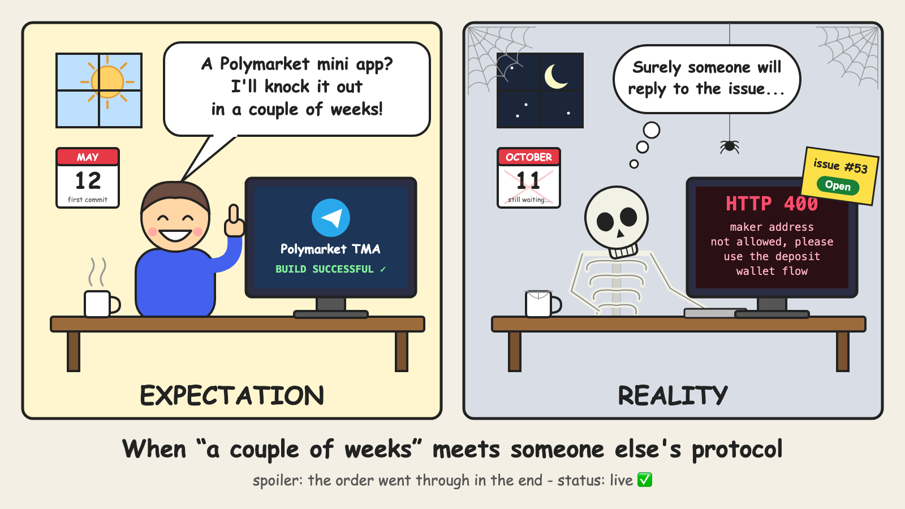

# Polymarket in Telegram: how I spent five months fighting smart-wallet signatures (and won)

> Note to self, remove before publishing: upload the cover image (docs/assets/habr-kdpv_EN.png) in the LinkedIn article editor; app screenshots can be added to the text. The `slinkedin` tag in the link is there so LinkedIn referrals show up in "Platform statistics" → "Channels".



I have a habit: I read a news story and immediately go to Polymarket to see what the market thinks. Elections, matches, bitcoin, "will so-and-so release such-and-such before the end of the year". The price of a "Yes" share there equals the probability: 0.63 means 63%. Very intuitive, and very addictive.

There was one inconvenience: I spend half my day in Telegram, while Polymarket is a separate website, a wallet, all that stuff. At some point I thought: "How hard can it be? I'll build a mini app in a couple of weeks." The first commit landed on May 12, 2026.

Spoiler: the couple of weeks stretched into five months, two of which the project spent sitting on a shelf. And almost all the rest of the time went not into the UI, but into getting Polymarket to accept even a single order from me. That's what this post is about - with code, pitfalls, and the moment I gave up (temporarily).

## What I ended up with

So you know what we're talking about:

- a market feed with charts in 17 languages, with market titles translated too;
- **free predictions**: you tap "Yes" or "No", and when the market closes, the bot DMs you whether you were right. Accuracy is tracked, and there's a weekly leaderboard;
- **real bets** through Polymarket's official order book. The money sits in the user's wallet, not with me, and there's no gas to pay;
- you can sell a position before resolution and claim winnings in one tap;
- sharing markets to chats, inline mode, images for posts and Stories;
- referrals: part of the fee automatically goes to whoever invited you.

The stack is boring, and that's a good thing: Java 21 + Spring Boot 3.3, Postgres, Redis, web3j on the backend; React + Vite + TypeScript on the frontend; Privy for wallets. Everything runs in Docker Compose on a single DigitalOcean droplet. Right now it's roughly 12.5k lines of Java and 10k of TypeScript.

## The first weeks: everything goes suspiciously well

The start was brisk. Telegram passes the mini app an `initData` string with user data and an HMAC signature. The backend verifies it with a key derived from the bot token and issues its own JWT. From there it's a regular REST API, nothing interesting.

The interesting part began when I opened the app in a regular browser and got a 401. I spent twenty minutes hunting for a bug in the validator, and then remembered: outside Telegram `initData` is empty, the frontend substitutes a stub, and prod honestly rejects it. Working as designed - I'd just forgotten how I designed it.

As for the wallet, I decided right away: no "install MetaMask". In Telegram that instantly loses you nearly every user. I went with Privy: it creates an embedded wallet when you log in via Telegram, and signing happens right in the UI. There are no keys on my server, and that matters: I don't want to hold other people's money.

The first Privy pitfall: `VITE_PRIVY_APP_ID` is baked into the bundle at build time. I changed it in `.env` on the server and stared at a white screen for a long time. Then I rebuilt the image - and it worked.

Markets, charts, the order book, the first orders from a regular wallet - by the end of May all of that worked. In my head I was already writing a "look what I made" post.

## And then Polymarket said "no"

```
maker address not allowed, please use the deposit wallet flow
```

In spring 2026 Polymarket stopped accepting orders from regular wallets (EOAs). Now every user must have a **deposit wallet** - a smart wallet owned by their EOA. Documentation: next to nothing. Official SDKs: TypeScript and Python. And I'm on Java.

This is where I honestly gave up. Well, almost. To keep the project moving, I spent a couple of weeks building a workaround: internal parimutuel betting with my own treasury and automatic settlement based on market outcomes. It worked, but it wasn't "the real thing". Money flowed through me, the only liquidity was my own, and that was exactly what I wanted to avoid.

### A two-month pause

At first, of course, I assumed the problem was me. I re-checked keys, addresses, signatures. I created a fresh wallet that had never touched polymarket.com - same error. Then I went googling and found [issue #53](https://github.com/Polymarket/py-clob-client-v2/issues/53) in the official Python client's repo with my error word for word. Someone had done exactly the same thing: fresh wallet, code from the README - and got the same `maker address not allowed`.

I scrolled through [the other issues](https://github.com/Polymarket/py-clob-client-v2/issues) - and found a whole collection: "invalid signature", "invalid signer address", "call blocked". Different for everyone, and working for no one. The issue was still open.

And then I made a decision I'm not very proud of, but which was probably the right one: this is a blocker. If Polymarket's own official SDK can't place an order, then my Java client, written against that SDK, certainly can't. Poking at a closed protocol blindly with no documentation leads nowhere.

I closed the laptop, and the project sat on the shelf for two months.

When I looked at those same issues again, the picture had changed. They were still open, but next to them was a new [issue #111](https://github.com/Polymarket/py-clob-client-v2/issues/111) with a workaround: the author had dug down to the fact that V2 requires a `POLY_1271` signature with a nested ERC-7739 signature, which the Python SDK simply can't produce, and verified it with the Rust client. So it wasn't me and it wasn't Java - the protocol itself had gained something the SDK didn't have.

That was enough. In October I returned to real trading, firmly intending to get to the bottom of it.

The lesson I took away: if you've hit someone else's bug, subscribe to the issue and go do something else. Sometimes the best way to solve a problem is to wait until someone else solves it. Just don't forget to come back.

## Figuring out the deposit wallet

In short, here's how it works.

**The wallet address is known in advance.** It's computed via CREATE2 from the EOA address, so you can calculate it before deployment. This later turned out to be very handy for referrals.

**The user doesn't pay gas.** Deploying the wallet, approvals, transfers, claiming winnings - all of these are "batches" of calls. The user signs a batch, and the Polymarket Relayer executes it at its own expense. For a mass audience this is a huge plus: nobody is going to figure out where to get MATIC.

**The currency is pUSD, not USDC.e.** It's wrapped USDC. Deposits go through Polymarket Bridge: you give it an address, and it hands back deposit addresses on EVM, Solana, and Tron. Whatever you send there, pUSD arrives.

**The order is signed as `POLY_1271`** (`signatureType = 3`), and the `maker` field now holds the smart wallet.

### The most painful part: the signature

The smart wallet verifies signatures via ERC-1271. But you can't just sign the order: Polymarket uses an ERC-7739 wrapper. The EOA doesn't sign the order itself, but a `TypedDataSign` struct with the order nested inside as `contents`. Then you have to assemble a final 317-byte signature from it: the EOA signature, the domain separator, the contents hash, the type description, and its length.

Get a single byte wrong and the CLOB just says "invalid signature". No details, of course.

What saved me: I stopped guessing. Next to the project I wrote a small script on the official TS SDK (`tools/clob-v2-probe`) that produces a reference order. A Java unit test compares my assembly against it byte for byte. As soon as the test went green, the order went to the CLOB and came back with status `live`.

I don't know how to describe that feeling. Five months (okay, three not counting the pause), and there it is: `live`. That order now lives in the tests as the reference - let it stand guard.

**Advice if you're writing a client for someone else's protocol in a "non-native" language:** first build a verification script on the official SDK and compare bytes in your tests. It'll save you days, maybe even weeks.

### Why only the server assembles batches

For the relayer to accept a batch, you need the platform's builder key - that is, mine. If the client could submit any batch, anyone could execute anything with my key. So the scheme is:

1. The server builds the calls itself (approve, transfer, redeem…) and stores them in Redis for 10 minutes.
2. The client receives only the EIP-712 data to sign.
3. The client returns the hash and the signature. The server looks up the batch by hash, checks that it was signed by the actual owner of that wallet, and only then sends it to the relayer.

## The little things that ate the most time

The first real user order (okay, mine) failed. It turns out each market has its own tick size (0.01 or 0.001) and its own minimum order size. The CLOB rejects `5.004 @ 0.537` on a market with a 0.01 tick. Now the server rounds the size to the right step itself and, if something's off, explains it in plain language: "minimum N shares ≈ $X".

I added selling later, and a trap was waiting for me there. On a buy, `makerAmount` is dollars and `takerAmount` is shares. On a sell, it's exactly the opposite. Sounds obvious, but when you reuse the buy code "with a few tweaks", mixing them up is the easiest thing in the world.

On the frontend you can't offer to sell more than the user has. Like this, with an epsilon:

```ts
export function floorShares(n: number): number {
  return Number.isFinite(n) ? Math.floor(n * 100 + 1e-9) / 100 : NaN;
}
```

Why the epsilon? Open a console and type `0.29 * 100`. Without it, a user holding 0.29 shares would hit "Sell all" and sell 0.28.

## Referrals without a "payout dashboard"

The platform takes a small fee on buys; selling is free. The fee is a separate batch of pUSD transfers that the user signs along with the order.

If the user came via a link, a second transfer - to the referrer - is simply added to the same batch. No "accumulate $50 and submit a withdrawal request": the share lands in the wallet in the same transaction. And since the deposit wallet address is known in advance, you can send the share even to someone who hasn't deployed their wallet yet. Only they will be able to claim it.

The terms are checked on every trade. Simplified, the logic looks like this:

```java
// Partner: their own percentage and term (null = indefinite).
// Everyone else: 25% for 6 calendar months from the invitee's sign-up.
Optional<Split> split(long userId, BigInteger feeMicro) {
    var ref = referrals.referrerOf(userId);
    if (ref.isEmpty()) return Optional.empty();
    var partner = partners.findActive(ref.get().referrerId());
    int bps = partner.map(Terms::shareBps).orElse(props.shareBps());
    Integer months = partner.isPresent() ? partner.get().months() : props.months();
    if (months != null && now().isAfter(ref.get().referredAt().atOffset(UTC).plusMonths(months))) {
        return Optional.empty();
    }
    return Optional.of(new Split(ref.get().referrerEoa(), feeMicro * bps / 10_000));
}
```

The upside of this approach: if you change a partner's terms, they immediately apply to all their future trades, and nothing needs to be recalculated.

## Unexpectedly: free is more addictive

I built free predictions as a "warm-up", something to do before you've funded your wallet. And I ended up opening them more often than the real bets myself.

Technically it's simple. A prediction is a row in Postgres. A background job checks which markets have closed, and the bot DMs the user in their language: right or wrong.

I calculate accuracy **only from free predictions**. If real bets counted, the yardstick would be the size of your wallet, not your intuition. Public accuracy is shown after 5 resolved predictions, and the weekly leaderboard includes only those with at least 3. Otherwise first place would go to someone with one lucky guess and 100% accuracy.

## Sharing, or how I drew images with Java2D

Telegram grows through forwards, so this is where I invested:

- **inline mode**: `@Polymarket_trader_nds_bot bitcoin` in any chat shows market cards with an "Open" button;
- **deep links**: the `startapp` parameter encodes everything at once - who invited you, where you came from, which market to open;
- **market images** at 1080×1080 and 1080×1920 for Stories.

The images are rendered on the server. I could have spun up headless Chrome, but I didn't want to spend the droplet's memory on it, so everything is drawn with plain Java2D: the question, the probability in large type, a weekly chart, an icon.

It all looked great until I opened a Chinese market. Instead of characters - neat little boxes. The JRE Docker image simply has no CJK fonts; fixed with one line (`fonts-noto-cjk`) in the Dockerfile.

Another discovery: `<a download>` doesn't work in Telegram's WebView. Downloading and posting to Stories are done via `postEvent('web_app_request_file_download')` and `web_app_share_to_story` from the WebApp API.

## The bug I chased longer than I should have

After claiming winnings, my positions list would crash. Not always - only on the second request.

Positions were cached in Redis via `GenericJackson2JsonRedisSerializer`. The first request bypasses the cache, all good. The second one reads from the cache, and `List<Position>` comes back as `List<LinkedHashMap>`: the generic type is erased, and Jackson doesn't know what to deserialize into. Result: `ClassCastException`.

The fix is normalizing on the way out:

```java
List<Position> toPositions(List<?> raw) {
    return raw.stream()
        .map(o -> o instanceof Position p ? p : mapper.convertValue(o, Position.class))
        .toList();
}
```

Bonus for SQL fans: Postgres can't do `FULL OUTER JOIN … ON a IS NOT DISTINCT FROM b` - a FULL JOIN needs a condition that allows a merge or hash join. I had to compare via `COALESCE(source, '')` instead.

## "Why can't I connect Wallet in Telegram?"

The most common question from friends. Lots of mini apps connect a wallet via TON Connect, but mine doesn't.

The answer is simple: Polymarket lives on Polygon, and the Bridge doesn't accept TON. But Wallet in Telegram can withdraw USDT on Solana and Tron, and the Bridge accepts those (from ~$2). So the app has a four-step hint: "copy the address → open Wallet → send USDT → wait a couple of minutes". Not as elegant as a single button, but it works.

## Boring but important

Polymarket isn't available everywhere. It's blocked in Russia, Ukraine, and Argentina; in Brazil you can only close positions; and about 40 more countries are restricted, including the US, the UK, and most of the EU. My app is an independent client, not an official Polymarket product, and these restrictions apply in it too: the CLOB itself rejects orders from restricted countries. Free predictions, charts, and sharing work everywhere.

Betting carries the risk of losing money, 18+. Yes, the UI says so too.

## What I took away from these five months

- **Don't guess, compare.** A reference from the official SDK plus byte comparison in tests is the best thing I did on this project.
- **No gas and no external wallets**, otherwise a Telegram user will never make it to their first bet.
- **Anything signed with the platform key is assembled by the server.** The client only gets the hash.
- **Free mechanics retain better than paid ones.** I didn't expect that.
- **"A couple of weeks" is never a couple of weeks.** But you knew that already.

If you've also wrestled with ERC-1271/ERC-7739 or built mini apps with crypto wallets, tell me in the comments how you solved it. There's very little written about this, and I'd be glad to compare approaches. Constructive criticism is welcome too.

Try what came out of it: https://t.me/Polymarket_trader_nds_bot?startapp=slinkedin
