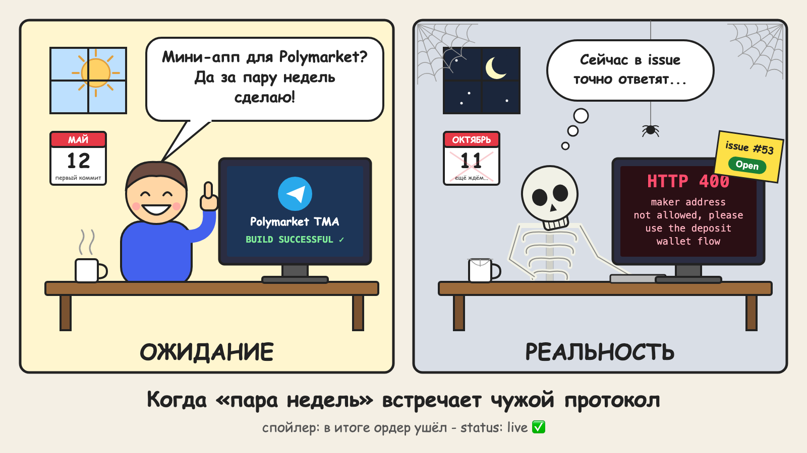

# Polymarket в Telegram: как я пять месяцев воевал с подписями смарт-кошельков (и победил)

*Хабы: Java, Блокчейн, Разработка под Telegram, Я пиарюсь*

> Примечание для себя, перед публикацией удалить: хаб «Я пиарюсь» обязателен, раз в конце ссылка на свой продукт. Картинку в начале (docs/assets/habr-kdpv.png) загрузить в редактор Хабра; скриншоты приложения можно добавить в текст. Метка `shabr` в ссылке - чтобы видеть переходы с Хабра в «Статистике платформы» → «Каналы».



Привет, Хабр!

У меня есть привычка: прочитал новость - сразу лезу на Polymarket смотреть, что думает рынок. Выборы, матчи, биткоин, «выпустит ли кто-то там что-то там до конца года». Цена доли «Да» там равна вероятности: 0.63 - это 63%. Очень наглядно и затягивает.

Неудобно было одно: полдня я сижу в Telegram, а Polymarket - это отдельный сайт, кошелёк, вот это всё. В какой-то момент я подумал: «Да что там сложного, сделаю мини-апп за пару недель». 12 мая 2026 года появился первый коммит.

Спойлер: пара недель растянулась на пять месяцев, два из которых проект вообще лежал на полке. И почти всё остальное время ушло не на интерфейс, а на то, чтобы Polymarket согласился принять от меня хотя бы один ордер. Об этом и расскажу - с кодом, граблями и моментом, когда я сдался (временно).

<cut />

## Что получилось в итоге

Чтобы было понятно, о чём речь:

- лента рынков с графиками на 17 языках, названия рынков тоже переведены;
- **прогнозы без денег**: жмёшь «Да» или «Нет», а когда рынок закрывается, бот пишет в личку, угадал ли ты. Считается точность, есть рейтинг недели;
- **реальные ставки** через официальный стакан Polymarket. Деньги лежат на кошельке пользователя, а не у меня, газ платить не нужно;
- можно продать позицию до итога и забрать выигрыш в один тап;
- шаринг рынков в чаты, inline-режим, картинки для постов и Stories;
- рефералка: часть комиссии автоматически уходит тому, кто пригласил.

Стек скучный, и это хорошо: Java 21 + Spring Boot 3.3, Postgres, Redis, web3j на бэке; React + Vite + TypeScript на фронте; Privy для кошельков. Всё крутится в Docker Compose на одном дроплете DigitalOcean. Сейчас это примерно 12,5 тыс. строк на Java и 10 тыс. на TypeScript.

## Первые недели: всё идёт подозрительно хорошо

Начало было бодрым. Telegram передаёт мини-аппу строку `initData` с данными пользователя и HMAC-подписью. Бэкенд проверяет её ключом от токена бота и выдаёт свой JWT. Дальше это обычное REST API, ничего интересного.

Интересное началось, когда я открыл приложение в обычном браузере и получил 401. Я минут двадцать искал баг в валидаторе, а потом вспомнил: вне Telegram `initData` пустой, фронт подставляет заглушку, а прод её честно отвергает. Работает как задумано, просто я забыл, как задумал.

С кошельком я решил сразу: никакого «установите MetaMask». В Telegram это мгновенная потеря почти всех пользователей. Взял Privy: он создаёт встроенный кошелёк при входе через Telegram, подписи идут прямо в интерфейсе. Ключей на моём сервере нет, и это важно: я не хочу хранить чужие деньги.

Первые грабли с Privy: `VITE_PRIVY_APP_ID` вшивается в бандл при сборке. Я поменял его в `.env` на сервере и долго смотрел на белый экран. Потом пересобрал образ - заработало.

Рынки, графики, стакан, первые ордера с обычного кошелька - к концу мая всё это работало. Я уже мысленно писал пост «смотрите, что я сделал».

## А потом Polymarket сказал «нет»

```
maker address not allowed, please use the deposit wallet flow
```

Весной 2026 Polymarket перестал принимать ордера от обычных кошельков (EOA). Теперь у каждого пользователя должен быть **deposit wallet** - смарт-кошелёк, которым владеет его EOA. Документации - с гулькин нос, официальные SDK - на TypeScript и Python, а у меня Java.

Вот тут я честно сдался. Ну, почти. Чтобы проект не стоял, я за пару недель сделал обходной путь: внутренние ставки по схеме parimutuel со своей казной и автоматическим расчётом по итогам рынков. Это работало, но было «не тем». Деньги шли через меня, ликвидность была только своя, а я как раз хотел этого избежать.

### Два месяца паузы

Сначала я, конечно, решил, что дело во мне. Перепроверил ключи, адреса, подписи. Завёл новый кошелёк, который ни разу не касался polymarket.com, - та же ошибка. Потом пошёл гуглить и нашёл в репозитории официального Python-клиента [issue #53](https://github.com/Polymarket/py-clob-client-v2/issues/53) с моей ошибкой слово в слово. Человек проделал ровно то же самое: свежий кошелёк, код из README - и получил тот же `maker address not allowed`.

Полистал [остальные issues](https://github.com/Polymarket/py-clob-client-v2/issues) - а там целая коллекция: то «invalid signature», то «invalid signer address», то «call blocked». У всех по-разному, и ни у кого не работает. Issue висит открытым.

И тут я принял решение, которым не очень горжусь, но которое, наверное, было правильным: это блокер. Если официальный SDK от самого Polymarket не может поставить ордер, то мой Java-клиент, написанный по этому SDK, тем более не сможет. Ковырять закрытый протокол вслепую без документации - путь в никуда.

Я закрыл ноутбук, и проект на два месяца лёг на полку.

Когда я снова заглянул в те же issues, картина поменялась. Сами они по-прежнему висели открытыми, но рядом появилось [issue #111](https://github.com/Polymarket/py-clob-client-v2/issues/111) с обходным путём: автор докопался, что V2 требует подписи `POLY_1271` с вложенной подписью ERC-7739, которую Python SDK просто не умеет формировать, и проверил это на клиенте для Rust. То есть дело было не во мне и не в Java - в самом протоколе появилось то, чего нет в SDK.

Этого было достаточно. В октябре я вернулся к нормальной торговле с твёрдым намерением разобраться до конца.

Мораль, которую я вынес: если упёрлись в чужой баг, подпишитесь на issue и займитесь чем-нибудь другим. Иногда лучший способ решить проблему - подождать, пока её решит кто-то ещё. Главное - не забыть вернуться.

## Разбираемся с deposit wallet

Если коротко, схема такая.

**Адрес кошелька известен заранее.** Он считается через CREATE2 от адреса EOA, так что посчитать его можно ещё до развёртывания. Позже это очень пригодилось для рефералки.

**Пользователь не платит газ.** Развёртывание кошелька, разрешения, переводы, получение выигрыша - всё это «пакеты» вызовов. Пользователь подписывает пакет, а Polymarket Relayer исполняет его за свой счёт. Для массового пользователя это огромный плюс: никто не будет разбираться, где взять MATIC.

**Валюта - pUSD, а не USDC.e.** Это обёрнутый USDC. Пополнение идёт через Polymarket Bridge: вы даёте ему адрес, он выдаёт адреса для депозита в EVM, Solana и Tron. Что бы вы туда ни отправили, приходит pUSD.

**Ордер подписывается как `POLY_1271`** (`signatureType = 3`), и в поле `maker` стоит уже смарт-кошелёк.

### Самое больное: подпись

Смарт-кошелёк проверяет подписи через ERC-1271. Но просто подписать ордер нельзя: Polymarket использует обёртку ERC-7739. EOA подписывает не ордер, а структуру `TypedDataSign`, внутри которой ордер лежит как `contents`. Потом из этого нужно собрать итоговую подпись на 317 байт: подпись EOA, разделитель домена, хеш содержимого, описание типа и его длина.

Ошибёшься хоть в одном байте - CLOB просто скажет «invalid signature». Без подробностей, конечно.

Что меня спасло: я перестал гадать. Рядом с проектом я сделал маленький скрипт на официальном TS SDK (`tools/clob-v2-probe`), который формирует эталонный ордер. Юнит-тест на Java сверяет мою сборку с ним байт в байт. Как только тест позеленел, ордер ушёл в CLOB и вернулся со статусом `live`.

Не знаю, как описать это чувство. Пять месяцев (ладно, три без учёта паузы), и вот он, `live`. Этот ордер теперь живёт в тестах как эталон, пусть охраняет.

**Совет, если вы пишете клиент к чужому протоколу на «неродном» языке:** сначала сделайте проверочный скрипт на официальном SDK и сравнивайте байты в тестах. Это сэкономит вам дни, а может, и недели.

### Почему пакеты собирает только сервер

Чтобы relayer принял пакет, нужен builder-ключ платформы, то есть мой. Если бы клиент мог прислать любой пакет, кто угодно исполнил бы моим ключом что угодно. Поэтому схема такая:

1. Сервер сам собирает вызовы (approve, transfer, redeem…) и кладёт их в Redis на 10 минут.
2. Клиент получает только данные EIP-712 для подписи.
3. Клиент возвращает хеш и подпись. Сервер находит пакет по хешу, проверяет, что подписал именно владелец этого кошелька, и только тогда отправляет его в relayer.

## Мелочи, которые съели больше всего времени

Первый настоящий ордер пользователя (ну ладно, мой) не прошёл. Оказалось, у каждого рынка свой шаг цены (0.01 или 0.001) и свой минимальный размер ордера. `5.004 @ 0.537` на рынке с шагом 0.01 CLOB отвергает. Теперь сервер сам приводит размер к нужному шагу и, если что-то не так, объясняет по-человечески: «минимум N долей ≈ $X».

Продажу я добавил позже, и тут меня ждала ловушка. В покупке `makerAmount` - это доллары, `takerAmount` - доли. В продаже ровно наоборот. Звучит очевидно, но когда переиспользуешь код покупки «чуть-чуть поменяв», перепутать - раз плюнуть.

На фронте нельзя предлагать продать больше, чем есть. Вот так, с эпсилоном:

```ts
export function floorShares(n: number): number {
  return Number.isFinite(n) ? Math.floor(n * 100 + 1e-9) / 100 : NaN;
}
```

Зачем эпсилон? Откройте консоль и наберите `0.29 * 100`. Без него у пользователя с 0.29 доли кнопка «Продать всё» продавала бы 0.28.

## Рефералка без «личного кабинета с выплатами»

Платформа берёт небольшую комиссию с покупок, продажа бесплатна. Комиссия - это отдельный пакет переводов pUSD, пользователь подписывает его вместе с ордером.

Если пользователь пришёл по ссылке, в тот же пакет просто добавляется второй перевод - пригласившему. Никаких «накопите $50 и подайте заявку на вывод»: доля приходит на кошелёк в той же транзакции. А поскольку адрес deposit wallet известен заранее, можно отправить долю даже тому, кто свой кошелёк ещё не развернул. Забрать её сможет только он.

Условия проверяются на каждой сделке. Упрощённо логика такая:

```java
// Партнёр: свой процент и срок (null = бессрочно).
// Все остальные: 25% в течение 6 календарных месяцев с регистрации приглашённого.
Optional<Split> split(long userId, BigInteger feeMicro) {
    var ref = referrals.referrerOf(userId);
    if (ref.isEmpty()) return Optional.empty();
    var partner = partners.findActive(ref.get().referrerId());
    int bps = partner.map(Terms::shareBps).orElse(props.shareBps());
    Integer months = partner.isPresent() ? partner.get().months() : props.months();
    if (months != null && now().isAfter(ref.get().referredAt().atOffset(UTC).plusMonths(months))) {
        return Optional.empty();
    }
    return Optional.of(new Split(ref.get().referrerEoa(), feeMicro * bps / 10_000));
}
```

Плюс подхода: если поменять условия партнёру, они сразу действуют на все его будущие сделки, и ничего не надо пересчитывать.

## Неожиданно: бесплатное затягивает сильнее

Прогнозы без денег я сделал «для разогрева», чтобы было чем заняться, пока не пополнил кошелёк. А в итоге сам открываю их чаще, чем ставки.

Технически всё просто. Прогноз - это строка в Postgres. Фоновая задача смотрит, какие рынки закрылись, и бот пишет в личку на языке пользователя: угадал или нет.

Точность я считаю **только по прогнозам без денег**. Если учитывать реальные ставки, мерилом станет толщина кошелька, а не интуиция. Публичная точность показывается после 5 закрытых прогнозов, а в рейтинг недели попадают те, у кого их минимум 3. Иначе первое место займёт человек с одним удачным угадыванием и точностью 100%.

## Шаринг, или как я рисовал картинки на Java2D

Telegram растёт пересылками, поэтому сюда я вложился:

- **inline-режим**: `@Polymarket_trader_nds_bot биткоин` в любом чате показывает карточки рынков с кнопкой «Открыть»;
- **deep links**: в параметре `startapp` закодировано всё сразу - кто пригласил, откуда пришёл, какой рынок открыть;
- **картинки рынков** 1080×1080 и 1080×1920 для Stories.

Картинки рисуются на сервере. Можно было поднять headless Chrome, но мне было жалко памяти на дроплете, поэтому всё нарисовано обычным Java2D: вопрос, вероятность крупно, график за неделю, иконка.

Всё было красиво, пока я не открыл китайский рынок. Вместо иероглифов - ровные квадратики. В Docker-образе с JRE просто нет CJK-шрифтов, лечится одной строкой (`fonts-noto-cjk`) в Dockerfile.

Ещё одно открытие: `<a download>` в WebView Telegram не работает. Скачивание и публикация в Stories делаются через `postEvent('web_app_request_file_download')` и `web_app_share_to_story` из WebApp API.

## Баг, который я ловил дольше, чем стоило

После получения выигрыша у меня падал список позиций. Не всегда, а только при втором запросе.

Позиции кэшировались в Redis через `GenericJackson2JsonRedisSerializer`. Первый запрос идёт мимо кэша, всё хорошо. Второй берёт из кэша, и `List<Position>` возвращается как `List<LinkedHashMap>`: generic-тип стёрт, Jackson не знает, во что десериализовать. Получаем `ClassCastException`.

Лечится нормализацией на выходе:

```java
List<Position> toPositions(List<?> raw) {
    return raw.stream()
        .map(o -> o instanceof Position p ? p : mapper.convertValue(o, Position.class))
        .toList();
}
```

Бонус для любителей SQL: `FULL OUTER JOIN … ON a IS NOT DISTINCT FROM b` Postgres не умеет - FULL JOIN хочет условие, по которому можно сделать merge- или hash-join. Пришлось сравнивать через `COALESCE(source, '')`.

## «А почему нельзя подключить Wallet в Telegram?»

Самый частый вопрос от знакомых. Многие мини-аппы подключают кошелёк через TON Connect, а у меня нет.

Ответ простой: Polymarket живёт на Polygon, а Bridge не принимает TON. Но Wallet в Telegram умеет выводить USDT в сетях Solana и Tron, а Bridge их принимает (от ~$2). Поэтому в приложении есть подсказка из четырёх шагов: «скопировать адрес → открыть Wallet → отправить USDT → подождать пару минут». Не так элегантно, как одна кнопка, но работает.

## Скучное, но важное

Polymarket доступен не везде. Он заблокирован в России, Украине и Аргентине, в Бразилии можно только закрывать позиции, ещё около 40 стран ограничены, включая США, Великобританию и большую часть ЕС. Моё приложение - независимый клиент, не официальный продукт Polymarket, и эти ограничения действуют и в нём: CLOB сам отклоняет ордера из закрытых стран. Прогнозы без денег, графики и шаринг работают везде.

Ставки - это риск потерять деньги, 18+. Да, в интерфейсе это тоже написано.

## Что я вынес из этих пяти месяцев

- **Не гадайте, сверяйте.** Эталон из официального SDK плюс сравнение байтов в тестах - лучшее, что я сделал за проект.
- **Без газа и без внешних кошельков**, иначе пользователь из Telegram не дойдёт до первой ставки.
- **Всё, что подписывается ключом платформы, собирает сервер.** Клиенту - только хеш.
- **Бесплатная механика держит лучше платной.** Этого я не ожидал.
- **«Пара недель» - это всегда не пара недель.** Но это вы и так знаете.

Если вы тоже возились с ERC-1271/ERC-7739 или делали мини-аппы с крипто-кошельками, расскажите в комментариях, как решали. Материалов на русском об этом почти нет, буду рад сравнить подходы. И конструктивной критике тоже рад.

Попробовать, что получилось: https://t.me/Polymarket_trader_nds_bot?startapp=shabr
