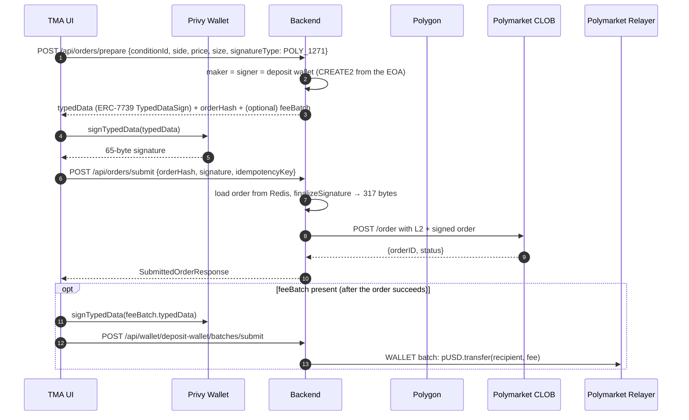
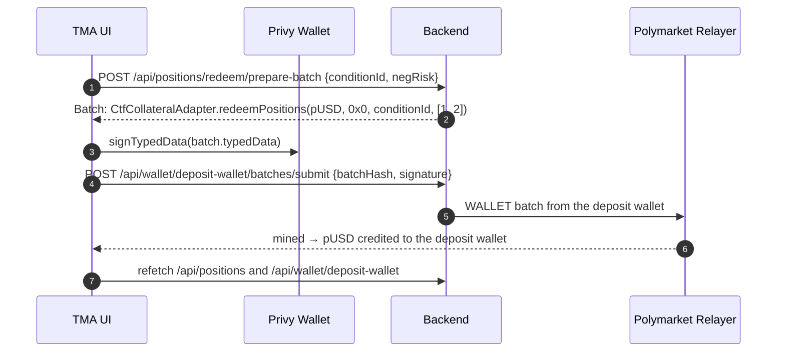

# Phase 2 — Trading status

> **Strategy (24 May 2026):** the **primary path for new users** is **internal parimutuel bets** — MVP (Phases 0–3) **done**. Plan: [internal-bets-plan_RU.md](./internal-bets-plan_RU.md). Step-by-step setup (RU): [bets-setup_RU.md](./bets-setup_RU.md).  
> **Update (11 Oct 2026): CLOB trading works again.** The "maker address not allowed, please use the deposit wallet flow" blocker is resolved: trading goes through the user's **deposit wallet** with `POLY_1271` signatures. Verified with a real order (`status: live`, then cancelled) — see "CLOB v2 via deposit wallet" below and `tools/clob-v2-probe/`.
> The mode is a flag: `BETS_ENABLED=true` — internal bets (`/api/bets/*`); `BETS_ENABLED=false` — Polymarket CLOB trading (`/api/orders/*`).

Polymarket trading settles on **CTF Exchange (Polygon)**. The backend never holds users’ private keys: the browser (**Privy** embedded wallet) signs **EIP-712** typed data; the backend posts the signed order to the **CLOB**.

## CLOB v2 via deposit wallet — ✅ working

Since April–May 2026 Polymarket rejects orders whose `maker` is a plain EOA. Each user trades through a **deposit wallet**: a smart wallet owned by their Privy EOA. Its address is deterministic (CREATE2); it is deployed and operated gaslessly through the **Polymarket Relayer** and funded through the **Polymarket Bridge**.

**Verified 2026-10-11** (test EOA `0x415a…` → deposit wallet `0xa1D1…bE57`): relayer deployment, USDT (Solana) top-up → 4.59 pUSD, approvals, API key, `POLY_1271` order accepted by CLOB (`status: live`) and cancelled. That order is the golden vector in `OrderBuilderTest`.

### Working configuration

| What | Value |
|---|---|
| API key (L1) | signed by the EOA, `POLY_ADDRESS` = EOA (unchanged) |
| Order | `signatureType=3` (`POLY_1271`), `maker` = `signer` = deposit wallet |
| Signature | the EOA signs an ERC-7739 `TypedDataSign` wrapper (order nested as `contents`); the backend packs the final 317-byte signature |
| Collateral | **pUSD** `0xC011a7E1…` (wrapped USDC), not USDC.e |
| Approvals | 10, in one batch: pUSD → both v2 exchanges, NegRiskAdapter, exchange v3; CTF → both v2 exchanges, NegRiskAdapter, both CTF collateral adapters; PositionManager → exchange v3 |
| Deploy / approvals / fee / Claim / withdraw | EIP-712 `Batch`es signed by the EOA and executed by the relayer — no gas for the user |
| Top-up | `POST bridge.polymarket.com/deposit` → EVM / Solana / Tron addresses; any supported stablecoin arrives as pUSD |

### Components

| Component | Where |
|---|---|
| POLY_1271 signing (ERC-7739 wrapper, `finalizeSignature`) | `trading/OrderBuilder.java` |
| Relayer client: wallet address, `WALLET-CREATE`, `WALLET` batches, builder HMAC | `trading/relayer/RelayerClient.java`, `DepositWalletAddress`, `DepositWalletBatch`, `BuilderAuthSigner` |
| Onboarding, approvals, generic batches | `trading/relayer/DepositWalletService.java`, `DepositWalletApprovals`, `PendingBatchCache` |
| Bridge top-up and withdrawal | `trading/bridge/BridgeClient.java`, `FundingService`, `WithdrawService` |
| Claim (pUSD via CTF collateral adapter) | `redeem/RedeemService.prepareBatch` |
| Frontend: wallet, Top up, Withdraw | `features/wallet/DepositWalletSection.tsx`, `FundingPanel.tsx`, `WithdrawPanel.tsx`, `relayerTx.ts` |
| Frontend: trade, Claim | `features/trading/ClobTradeSheet.tsx`, `PositionRow.tsx` |
| Probe on the official TS SDKs | `tools/clob-v2-probe/` |

### Endpoints (all require auth)

| Method | Path | Purpose |
|---|---|---|
| GET | `/api/wallet/deposit-wallet` | address, deployed, pUSD balance, 10 approvals, `readyToTrade` |
| POST | `/api/wallet/deposit-wallet/deploy` | `WALLET-CREATE` via relayer |
| POST | `/api/wallet/deposit-wallet/approvals/prepare` | batch with missing approvals |
| POST | `/api/wallet/deposit-wallet/batches/submit` | `{batchHash, signature}` → relayer (approvals, fee, Claim, withdrawal) |
| GET | `/api/wallet/deposit-wallet/transactions/{id}` | relayer transaction status |
| GET | `/api/wallet/deposit-wallet/funding` | bridge addresses and top-up options |
| GET | `/api/wallet/deposit-wallet/funding/deposits` | recent bridge top-ups |
| GET | `/api/wallet/deposit-wallet/withdraw/options` | withdrawal destinations and balance |
| POST | `/api/wallet/deposit-wallet/withdraw/prepare` | withdrawal batch (direct pUSD or via bridge) + bridge quote |
| POST | `/api/positions/redeem/prepare-batch` | Claim batch |

Batch calls are built **only by the server** (kept in Redis for 10 minutes); the client sends just the hash and signature, and the server checks the signer is the user's wallet. Builder credentials therefore cannot be used to relay arbitrary transactions.

### Operator setup

| Env | Purpose |
|---|---|
| `POLY_BUILDER_API_KEY`, `POLY_BUILDER_SECRET`, `POLY_BUILDER_PASSPHRASE` | builder key from polymarket.com → Settings → Builders; required for deploy, approvals, fee, Claim and withdrawal |
| `POLY_BUILDER_CODE` | optional bytes32 builder code for bridge transfer attribution |
| `RELAYER_URL`, `BRIDGE_URL` | default `relayer-v2.polymarket.com`, `bridge.polymarket.com` |
| `BETS_ENABLED=false` | show CLOB trading instead of internal bets |

Contract addresses live under `app.relayer.*` in `application.yml`.

### User journey

1. **Wallet → Connect Polymarket trading** — L1 signature, API key.
2. **Trading wallet → Activate** — deploy the deposit wallet.
3. **Approve** — one signature for all missing approvals.
4. **Top up** — pick a network and token, send to the bridge address; pUSD arrives in a few minutes.
5. **Trade** on a market page: sign the order; with a platform fee enabled, a second signature (pUSD transfer).
6. **Claim** a resolved position — sign a batch, payout in pUSD.
7. **Withdraw** — pUSD on Polygon, or a stablecoin on another network via the bridge (a quote is shown before signing).

### Limitations

- Only **CTF markets** (`clobTokenIds`, order version 2) are supported. Polymarket V2 positions (Router `0x1212…`, version-3 orders with `positionID`) are not handled.
- The bridge is expensive for small amounts: withdrawing $3 → USDT (Tron) quotes ≈ 1.60 USDT. The UI shows the quote and a warning before signing.
- Batches take the relayer nonce at prepare time: of two batches prepared at once, only one executes.
- Bridge withdrawals are not tracked after the pUSD leaves the wallet; the UI shows the send and the estimated time only.

## Phase 1 vs Phase 2 (implemented in-repo)

| Area | Phase 1 (read-mostly) | Phase 2 (trading scaffold) |
|------|------------------------|---------------------------|
| Markets, search | Gamma + public-search → list/detail | Same |
| Orderbook / prices | Gamma + CLOB public REST | Same |
| Price stream | CLOB WS → STOMP `/topic/market/{…}` (optional toggle) | Same |
| Identity | Telegram auth, JWT | Same |
| Wallet | Optional Privy when `VITE_PRIVY_APP_ID` | Privy on Polygon + USDC `balanceOf` via viem |
| Orders | — | `POST /api/orders/prepare`, `POST /api/orders/submit`, Redis pending cache, `order_audit` table |
| CLOB submit | — | `POST /order` with **L2 HMAC headers** when the user has derived credentials; falls back to unauthenticated post if not. L1 key derivation flow exposed at `/api/clob/auth/*` |
| Positions | — | `GET /api/positions` → Data API `GET /positions?user=<wallet>` (≈10s Redis cache); response includes title/icon/outcome/PnL/redeemable and a `favorite` flag joined from the local `favorite_market` table |
| Cancel | — | `DELETE /api/orders/{orderId}` → CLOB `DELETE /order` with L2 headers via `ClobL2Signer`. Returns `CLOB_AUTH_REQUIRED` if no credentials. |
| USDC / CTF approvals | — | `wallet/ApprovalCalldataBuilder`, `ApprovalStatusReader`, `ApprovalService`, `GET /api/wallet/approvals`; frontend `ApprovalsSection.tsx` |
| Canonical **order hash** | — | EIP-712 digest via web3j `StructuredDataEncoder`; `tokenId`/`uint256` fields emitted as decimal strings so Privy/viem do not lose precision |
| Redeem / claim winnings | — | `POST /api/positions/redeem/prepare` → unsigned `redeemPositions(...)` calldata. Frontend `PositionRow` exposes a Claim button per redeemable position. |
| Platform fee (spread) | — | `app.fees.spread-bps` + `app.fees.recipient-address`. When non-zero, `prepare` returns an extra USDC `transfer(recipient, fee)` tx the wallet broadcasts right after signing the order. Public preview at `GET /api/fees`. |

Key files:

- [OrderBuilder.java](../backend/src/main/java/com/polymarket/tma/trading/OrderBuilder.java)
- [PendingOrderCache.java](../backend/src/main/java/com/polymarket/tma/trading/PendingOrderCache.java)
- [TradingService.java](../backend/src/main/java/com/polymarket/tma/trading/TradingService.java)
- [ClobOrderClient.java](../backend/src/main/java/com/polymarket/tma/trading/ClobOrderClient.java)
- [PositionsClient.java](../backend/src/main/java/com/polymarket/tma/trading/PositionsClient.java)
- [RedeemCalldataBuilder.java](../backend/src/main/java/com/polymarket/tma/redeem/RedeemCalldataBuilder.java) · [RedeemService.java](../backend/src/main/java/com/polymarket/tma/redeem/RedeemService.java) · [RedeemController.java](../backend/src/main/java/com/polymarket/tma/redeem/RedeemController.java)
- [FeeCalldataBuilder.java](../backend/src/main/java/com/polymarket/tma/fees/FeeCalldataBuilder.java) · [FeeService.java](../backend/src/main/java/com/polymarket/tma/fees/FeeService.java) · [FeeController.java](../backend/src/main/java/com/polymarket/tma/fees/FeeController.java)
- [MarketTradeSheet.tsx](../frontend/src/features/trading/MarketTradeSheet.tsx) — prepare → Privy `signTypedData` → optional fee tx → submit
- [PositionRow.tsx](../frontend/src/features/trading/PositionRow.tsx) — inline Claim button per redeemable position
- [useWallet.ts](../frontend/src/features/wallet/useWallet.ts) — Privy wallets + Polygon USDC

## End-to-end order flow (current)



## End-to-end Claim flow (deposit wallet)



---

## Privy “Sign and continue” failures — plausible causes vs this codebase

Privy shows a generic **“An error has occurred, please try again.”** Surface the underlying error in DevTools/console if possible.

### 1. **`typedData` numeric encoding (mitigated in code)**

[`OrderBuilder.build`](../backend/src/main/java/com/polymarket/tma/trading/OrderBuilder.java) emits **all** `uint256` / `uint8` fields in `domain` and `message` as **decimal strings**, including **`chainId`** in the domain, so large `tokenId` values are never rounded in JSON and viem/Privy see a single convention.

If signing still fails, use DevTools/remote debugging — remaining causes are often **wrong chain**, **maker ≠ active wallet**, or **signatureType** mismatch.

### 2. **`wallets[0]` vs signer used for EIP-712**

[`useWallet`](../frontend/src/features/wallet/useWallet.ts) resolves `address` from `wallets[0]`. Embedded vs external ordering can pick the wrong signer. Signing uses `{ address: w.address }`, while `maker`/`signer` in typed data come from the DB profile (**after `api.setWalletAddress`**). Any mismatch yields signing or verification errors.

Prefer selecting the exact **embedded Polygon wallet** that matches saved profile / `typedData.message.maker`.

### 3. **`signatureType` vs wallet model**

For new wallets CLOB accepts **`POLY_1271`** (deposit wallet) only, and `ClobTradeSheet` always sends it. EOA (`0`) is rejected with `CLOB_DEPOSIT_WALLET_REQUIRED`.

### 4. **`orderHash` vs CLOB bookkeeping**

The API’s `orderHash` is the **EIP-712 struct hash** from web3j `StructuredDataEncoder` (same digest the wallet uses when signing). CLOB may still use additional ids once L1/L2 submit is wired; treat server `orderHash` as the canonical digest of the prepared typed data.

---

## L1 / L2 CLOB auth (backend wiring)

Implemented in `backend/src/main/java/com/polymarket/tma/trading/clob`:

- `ClobAuthBuilder` — builds the EIP-712 `ClobAuth` typed data the wallet signs (domain `ClobAuthDomain`, chainId 137). All uint values are decimal strings.
- `ClobApiKeyClient` — `POST /auth/api-key` with `POLY_ADDRESS / POLY_SIGNATURE / POLY_TIMESTAMP / POLY_NONCE` headers. Returns `(apiKey, secret, passphrase)`.
- `ClobCredentialsStore` — Redis-cached creds per user with a 30 day TTL.
- `ClobL2Signer` — HMAC-SHA256 over `timestamp + METHOD + path + body`; URL-safe base64 in, URL-safe base64 out (mirrors py-clob-client).
- `ClobAuthController` — `/api/clob/auth/prepare | submit | status` (auth required), `DELETE /api/clob/auth` to wipe creds.
- `ClobOrderClient.submit(...)` — attaches `POLY_*` headers when `creds` are present.
- `ClobOrderClient.cancel(orderId, wallet, creds)` — `DELETE /order` with L2 headers and `{"orderID": ...}` body.

Frontend wiring:

1. Wallet page → "Connect to Polymarket trading" button:
   - `POST /api/clob/auth/prepare`
   - Privy `signTypedData(typedData)`
   - `POST /api/clob/auth/submit { signature, timestamp, nonce }`
2. On order rejection with 401/403 from CLOB the frontend wipes creds (`DELETE /api/clob/auth`) and prompts to re-derive.

## Approvals (USDC + Conditional Tokens) — legacy EOA

> This section covers the old EOA path (USDC.e, user-paid gas). Deposit wallets use `DepositWalletApprovals` (10 approvals, pUSD) and `/api/wallet/deposit-wallet/approvals/prepare`; `ApprovalsSection.tsx` is no longer rendered.

Implemented in `backend/src/main/java/com/polymarket/tma/wallet`:

- `ApprovalCalldataBuilder` — pure ABI encoding for `approve(address,uint256)` (selector `0x095ea7b3`) and `setApprovalForAll(address,bool)` (selector `0xa22cb465`).
- `ApprovalStatusReader` — optional Polygon JSON-RPC reader for `allowance` (USDC) and `isApprovedForAll` (CTF). Returns `null` if RPC fails so callers degrade gracefully.
- `ApprovalService` — composes `UnsignedTx` list (`to`, `data`, `value=0x0`, `chainId=137`) for whatever is missing. USDC threshold ≥ `1_000_000` units (1 USDC) is treated as approved.
- `ApprovalController` — `GET /api/wallet/approvals` (auth required).

Polygon addresses (in `application.yml`):

| Key | Value |
|-----|-------|
| `app.polygon.usdc-address` | `0x2791Bca1f2de4661ED88A30C99A7a9449Aa84174` |
| `app.polygon.ctf-address` | `0x4D97DCd97eC945f40cF65F87097ACe5EA0476045` |
| `app.polygon.ctf-exchange-address` (CTF Exchange v2) | `0xE111180000d2663C0091e4f400237545B87B996B` |
| `app.polygon.neg-risk-ctf-exchange-address` (NegRisk CTF Exchange v2) | `0xe2222d279d744050d28e00520010520000310F59` |

> **Note (CLOB v2 migration, 2026-04-22).** Polymarket migrated to a new CTF Exchange contract pair on 2026-04-22; the legacy v1 exchange (`0x4bFb41d5B3570DeFd03C39a9A4D8dE6Bd8B8982E`) has been rejecting new orders with `400 "order_version_mismatch"` since 2026-04-30. Existing USDC / CTF approvals on the v1 contract are useless — users must re-approve the v2 exchange on first trade. See `OrderBuilder` for the new EIP-712 schema and [py-clob-client-v2](https://github.com/Polymarket/py-clob-client-v2) for the upstream reference.

### Deposit-wallet flow — resolved (October 2026)

Since May 2026 CLOB answers an order with an EOA `maker` with `400 "maker address not allowed, please use the deposit wallet flow"` (mapped to `CLOB_DEPOSIT_WALLET_REQUIRED`). The py-clob-client-v2 issues (#51, #53, #61, #63, #64, #111, #116) mostly described Python SDK gaps. The working configuration was confirmed by the community in [#70](https://github.com/Polymarket/py-clob-client-v2/issues/70) and by our own probe on 2026-10-11: API key on the EOA, order `signatureType=3` with `maker = signer = deposit wallet`. No polymarket.com onboarding is needed — the wallet is deployed via the relayer. Details in "CLOB v2 via deposit wallet" at the top of this document.

Frontend wiring (`ApprovalsSection.tsx`): calls `GET /api/wallet/approvals`, sends each `missing[i]` as a regular Polygon tx via Privy (`{to, data, value:'0x0', chainId:137}`), refetches afterwards.

## Redeem (claim winnings)

Implemented in `backend/src/main/java/com/polymarket/tma/redeem`:

- `RedeemCalldataBuilder` — pure ABI encoding for `redeemPositions(IERC20,bytes32,bytes32,uint256[])` on the Conditional Tokens Framework. `parentCollectionId` defaults to the all-zero bytes32 (top-level Polymarket markets); `indexSet = 1 << outcomeIndex` for the position the user wants to burn.
- `RedeemService` — given `(conditionId, outcomeIndex)` + the caller's wallet, returns an `UnsignedTx` targeting `app.polygon.ctf-address`.
- `RedeemController` — `POST /api/positions/redeem/prepare` (auth required).

Frontend wiring (`PositionRow.tsx`): Claim button rendered when `position.redeemable === true`. Positions held by the deposit wallet use `RedeemService.prepareBatch` (`POST /api/positions/redeem/prepare-batch`): the batch calls `redeemPositions(pUSD, 0x0, conditionId, [1, 2])` on **CtfCollateralAdapter** `0xAdA1…cE1f` or **NegRiskCtfCollateralAdapter** `0xadA2…eAab` (by the position's `negativeRisk`), paying out pUSD directly. The old `POST /api/positions/redeem/prepare` (EOA tx to CTF, paid in USDC.e) remains for legacy and is no longer called by the frontend.

## maker / signer per `signatureType`

`PrepareOrderRequest` gains an optional **`makerAddress`** field. Resolution in `TradingService.prepare`:

| signatureType | maker | signer |
|----------------|-------|--------|
| `EOA` (default) | wallet | wallet |
| `POLY_PROXY` | required `makerAddress` (proxy) | wallet |
| `POLY_GNOSIS_SAFE` | required `makerAddress` (Safe) | wallet |
| `POLY_1271` (deposit wallet) | deposit wallet, derived from the wallet; `makerAddress` optional but must match (`MAKER_MISMATCH`) | deposit wallet (the EOA signs the ERC-7739 wrapper) |

For `POLY_PROXY` / `POLY_GNOSIS_SAFE` the request fails with `MAKER_REQUIRED` if `makerAddress` is missing, or `MAKER_EQUALS_SIGNER` if equal to the wallet. `OrderBuilder.build(maker, signer, req)` writes the two distinct fields into the EIP-712 message.

---

## CLOB v2 order schema

Polymarket replaced their CTF Exchange in April 2026; the new schema is what `OrderBuilder` and `ClobOrderClient` now build. Fields and where they are emitted on the wire:

| Field | EIP-712 type | Wire JSON type | Notes |
|-------|--------------|----------------|-------|
| `salt` | `uint256` | **JSON number** | Generated < 2^53 to survive float64 server-side parsing |
| `maker` | `address` | string | Who holds the funds: deposit wallet (POLY_1271), EOA, proxy or Safe |
| `signer` | `address` | string | Who signs; for POLY_1271 the deposit wallet itself (validated via ERC-1271) |
| `tokenId` | `uint256` | string | Decimal big-int — 256 bits, so JSON number would lose precision |
| `makerAmount` / `takerAmount` | `uint256` | string | 6-decimal USDC or share units |
| `side` | `uint8` (0/1) | `"BUY"`/`"SELL"` string | Wire encoding differs from signed digest — CLOB reconstructs server-side |
| `signatureType` | `uint8` | **JSON number** | 0=EOA, 1=POLY_PROXY, 2=POLY_GNOSIS_SAFE, 3=POLY_1271 |
| `timestamp` | `uint256` | string ms | NEW in v2; replaces the v1 `nonce` for uniqueness |
| `metadata` | `bytes32` | hex string | NEW in v2; defaults to `0x00…00` |
| `builder` | `bytes32` | hex string | NEW in v2; defaults to `0x00…00` (set for builder attribution) |
| `expiration` | — *(API-only)* | string seconds | Wire-only in v2; NOT part of the signed digest. Default `"0"` (no expiry) |
| `signature` | — | string | Lives **inside** the `order` object. For POLY_1271: 317 bytes — `EOA signature ‖ app domain separator ‖ hash(order) ‖ Order type string ‖ uint16 length` |

Top-level envelope:

```json
{
  "order": { ... },
  "owner": "<API key UUID>",
  "orderType": "GTC",
  "deferExec": false,
  "postOnly": false
}
```

`owner` is the L2 API key UUID in v2 (the wallet maker in v1). The EIP-712 domain is `name="Polymarket CTF Exchange"`, **`version="2"`**, `chainId=137`, with `verifyingContract` switching between standard and NegRisk based on `MarketDto.negRisk`.

Regression coverage: [`OrderBuilderTest`](../backend/src/test/java/com/polymarket/tma/trading/OrderBuilderTest.java) (struct shape, salt range, NegRisk routing) and [`ClobOrderClientPayloadTest`](../backend/src/test/java/com/polymarket/tma/trading/ClobOrderClientPayloadTest.java) (wire JSON shape, `owner`, `deferExec`/`postOnly`, presence/absence of v1 fields).

---

## Monetization — configurable spread / fee

A platform fee can be charged on every prepared order. It is **independent** of the CLOB-side `feeRateBps` (which is reserved for the exchange operator) and lands as a regular ERC-20 `transfer` on Polygon to a configured wallet.

### Configuration (`application.yml`)

| Key | Env | Default | Description |
|-----|-----|---------|-------------|
| `app.fees.spread-bps` | `TRADING_FEE_BPS` | `0` | Fee in basis points (100 = 1%, 50 = 0.5%). `0` disables. |
| `app.fees.recipient-address` | `TRADING_FEE_RECIPIENT` | `""` | Polygon USDC recipient. Empty disables. |

### Wire-level flow

1. `POST /api/orders/prepare` builds the order; [`FeeService.quote`](../backend/src/main/java/com/polymarket/tma/fees/FeeService.java) computes `fee = price × size × spreadBps / 10_000` (USDC, 6 decimals) and produces an `UnsignedTx` for `USDC.transfer(recipient, fee)`.
2. The backend response carries the original `typedData` + `orderHash` and adds:

   ```json
   {
     "feeTx": { "kind": "TRADING_FEE_TRANSFER", "to": "<USDC>", "data": "0xa9059cbb…", "value": "0x0", "chainId": 137 },
     "feeAmountUsdc": "0.025",
     "feeBps": 50
   }
   ```
3. Frontend `MarketTradeSheet`:
   - signs the order via Privy `signTypedData`,
   - if `feeTx` is present, broadcasts it via Privy `useSendTransaction`,
   - submits `{orderHash, signature}` to `POST /api/orders/submit`.
4. `GET /api/fees` exposes the public fee config so the trade sheet can render the preview row (`Platform fee 0.50% · ≈ $0.025 USDC`) before the user signs anything.

### Fee for deposit wallets (POLY_1271)

For `POLY_1271` orders the `prepare` response carries **`feeBatch`** instead of `feeTx`: a `pUSD.transfer(recipient, fee)` batch from the deposit wallet. `ClobTradeSheet` signs it **after** the order is accepted and hands it to `batches/submit`; the relayer pays gas. Net effect for the user: two signatures per trade. If the fee fails, the order stands and the user sees a warning.

### Why a separate transfer (and not the CLOB `feeRateBps`)

Polymarket’s `feeRateBps` field on the EIP-712 order goes to the **CLOB operator**, not to a third-party wallet, so it cannot route the platform’s share. The cleanest MVP is to issue a USDC transfer immediately after signing: it is a single extra Polygon tx, gas is paid by the user, and the operator wallet sees a clean `transfer(...)` per bet.

### Limitations / follow-ups

- The fee is charged at **submission**, not at fill. If the order never matches, the fee is still collected — that is the intended "bet placement" pricing model. If you need fill-only fees, switch to a custodial smart-contract escrow.
- EOA orders pay fee gas in POL; deposit-wallet orders need no gas (relayer).
- `order_audit` does not yet record `fee_amount` / `fee_tx_hash`. Adding two columns + a Flyway migration is on the production checklist below.

## Geoblock — Polymarket CLOB region restrictions

CLOB sits behind Cloudflare and rejects `POST /order` (and several other endpoints) with HTTP **403 "Trading restricted in your region"** when the server's outbound IP falls into a restricted jurisdiction. The backend recognises that response shape and surfaces a dedicated error code `CLOB_GEOBLOCKED` so the UI / logs make the root cause obvious.

### Hosting strategy

Polymarket's geoblock list is wider than just "EU". It is enforced via Cloudflare WAF on `POST /order` (and several other endpoints) using IP-geo + ASN signals. Empirically verified against the real CLOB on this project (and corroborated by [polymarket/clob-client#231](https://github.com/Polymarket/clob-client/issues/231) and [Polymarket Help Center — Geographic Restrictions](https://help.polymarket.com/en/articles/13364163-geographic-restrictions)):

| Region | International CLOB | Notes |
|---|---|---|
| Hetzner **HEL1** (Helsinki, Finland) | **works** | Cheapest reliable option (~€5/mo). Recommended for MVP. |
| AWS **eu-west-1** (Dublin, Ireland) | **works** | Polymarket matching engine sits in AWS eu-west-2 London → ~0.5 ms latency from Dublin. Best for HFT-style integrators. |
| Vultr **Stockholm / Madrid** | usually works | Subject to confirmation per /24 — verify with `clob-post-probe`. |
| DigitalOcean **ams3** (Amsterdam) | conditional | Polymarket UI is blocked for NL but several integrators report the CLOB API path itself works. Cheap to A/B test before committing. |
| DigitalOcean **fra1 / lon1**, Hetzner **NBG/FSN/HEL FRA**, Scaleway Paris | blocked (Germany / UK / FR all geoblocked) | |
| DigitalOcean / AWS **US regions** (incl. nyc1, sfo3, us-east-1) | blocked | The international CLOB rejects US IPs; Polymarket runs a separate CFTC-regulated US API (KYC required, different endpoint). |
| DigitalOcean **tor1 / sgp1 / blr1** | blocked | CA / SG / IN. |

**Do not use residential / VPN proxies** (Bright Data Residential, Oxylabs Residential, mobile-carrier IPv6 pools): even when Cloudflare classifies the egress IP as `loc=US`, Polymarket's WAF flags those ranges as `proxy/threat_score>5` and blocks the same `POST /order`. Polymarket's Terms of Service §2.1.4 also explicitly forbid VPN/evasion. Datacenter IPv4 in an allowed jurisdiction is the only sustainable path.

### Operator diagnostics (`/api/diagnostics/*`)

The backend exposes three public probes that go through the same `WebClient` the trading flow uses, so connectivity issues can be triaged without redeploying:

| Endpoint | Purpose |
|---|---|
| `GET /api/diagnostics/clob-egress-ip` | Egress IP via `ifconfig.me/ip` — confirms what the upstream sees. |
| `GET /api/diagnostics/cf-trace` | Cloudflare's `cdn-cgi/trace`. Most important field: `loc=`. Must be `US` after deploy/migration. |
| `GET /api/diagnostics/clob-post-probe[?ua=...]` | Empty `POST /order`. Healthy region returns 400/401/422 (real signing path passes through the WAF). 403 + "Trading restricted" means the host is in a blocked region. Optional `ua` overrides User-Agent. |

These are not behind auth on purpose — they don't reveal credentials, only the externally visible IP and Cloudflare classification.

### Trade flow ordering

The frontend trade flow is `prepare → sign → submit → fee tx`. If CLOB rejects the order (geoblock or otherwise) the on-chain platform fee is **not** charged. Earlier the fee ran first, so a geoblocked submit would leave the user paying for nothing.

## Production TODO (remaining)

1. **Audit fee tx hash** on the `order_audit` row (`fee_amount`, `fee_recipient`, `fee_tx_hash`) — Flyway `V2__order_audit_fees.sql` + service plumbing.
2. **Notifications** for "market resolved / claim available" (`docs/ToDo.txt` C):
   - polling `/api/positions` per active user every N minutes,
   - cross-reference `redeemable=true` and emit a Telegram Bot message via the existing `app.telegram.bot-token`,
   - debounce per `(user, conditionId)` so the same payout is announced once.
3. **End-to-end live check in the TMA** on a deposit wallet (activate → approvals → top-up → order → fee → Claim → withdraw) with production builder credentials.
4. **Bridge withdrawal tracking** via `/status/{address}`; remove legacy (`ApprovalsSection.tsx`, `/api/wallet/approvals`, `/redeem/prepare`).
5. **Cancel UI** — there is no list of open CLOB orders rendered to the user yet, so the wired `DELETE /api/orders/{id}` endpoint waits on a "My orders" screen.

---

## Risk controls

- Redis token bucket per user on order endpoints when enabled.
- Cap `makerAmount` / notional pre-submit server-side.
- Geo/KYC gates before unlocking trading flows.
- `app.trading.enabled=false`-style killswitch when wired.
- Fee killswitch: set `app.fees.spread-bps=0` to disable monetization without redeploying anything else.
